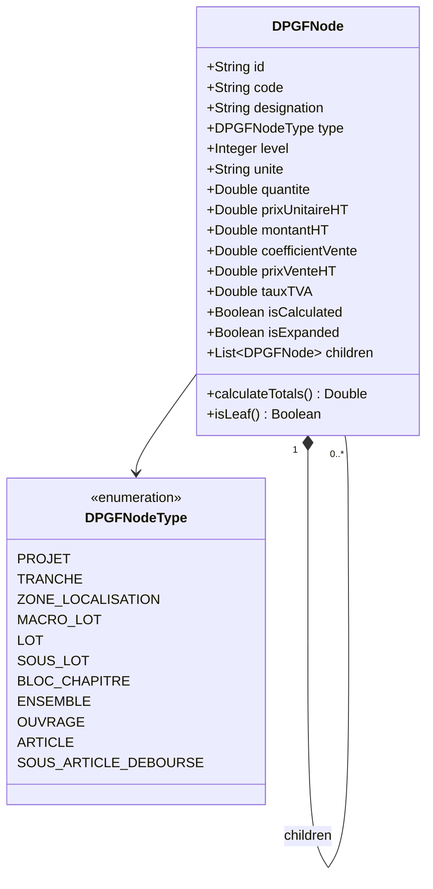

# Logique des DPGF & Méta-Modèle d'Arborescence Universelle BTP

> **Document de Référence Technique & Métier**  
> **Objet :** Analyse exhaustive des structures de DPGF (Décomposition du Prix Global et Forfaitaire), terminologie normalisée du BTP, comparaison des arborescences et spécification d'un **Arbre Universel** capable d'intégrer tous les styles de classeurs DPGF.

Ce document est accessible également à la racine du workspace : [logique.md](file:///c:/Users/DELL/Desktop/audit/logique.md).

---

## Sommaire

1. [Fondements & Rôle de la DPGF dans le BTP](#1-fondements--rôle-de-la-dpgf-dans-le-btp)
2. [Dictionnaire Sémantique : Décryptage des Mots-Clés](#2-dictionnaire-sémantique--décryptage-des-mots-clés)
3. [Les Grandes Familles d'Arborescences Rencontrées](#3-les-grandes-familles-darborescences-rencontrées)
   - [Structure 1 : L'Arborescence Classique UNTEC / Marchés Publics (3 niveaux)](#structure-1--larborescence-classique-untec--marchés-publics-3-niveaux)
   - [Structure 2 : L'Arborescence Entreprise Générale / Étude de Prix (4-5 niveaux)](#structure-2--larborescence-entreprise-générale--étude-de-prix-4-5-niveaux)
   - [Structure 3 : L'Arborescence Spatiale & Géographique (Par Bâtiment / Niveau / Zone)](#structure-3--larborescence-spatiale--géographique-par-bâtiment--niveau--zone)
   - [Structure 4 : L'Arborescence Systémique / Macro-Lots & Ensembles Préfabriqués](#structure-4--larborescence-systémique--macro-lots--ensembles-préfabriqués)
   - [Structure 5 : L'Arborescence Hybride Eco-Pilot (Niveaux 1/2, Blocs, Ouvrages, Articles)](#structure-5--larborescence-hybride-eco-pilot-niveaux-12-blocs-ouvrages-articles)
4. [Étude Comparative : Avantages & Limites de Chaque Modèle](#4-étude-comparative--avantages--limites-de-chaque-modèle)
5. [Spécification de « L'Arbre Universel » (Méta-Modèle Polymorphique)](#5-spécification-de--larbre-universel--méta-modèle-polymorphique)
6. [Algorithmes d'Auto-Détection lors de l'Import Excel](#6-algorithmes-dauto-détection-lors-de-limport-excel)
7. [Exemple Comparatif d'un Cas Concret : Fondations & Radier Hôtel](#7-exemple-comparatif-dun-cas-concret--fondations--radier-hôtel)
8. [Conclusion & Recommandations d'Intégration Logicielle](#8-conclusion--recommandations-dintégration-logicielle)

---

## 1. Fondements & Rôle de la DPGF dans le BTP

### 1.1. Qu'est-ce qu'une DPGF ?
La **DPGF (Décomposition du Prix Global et Forfaitaire)** est la pièce financière maîtresse des marchés de travaux passés à **prix forfaitaire** (au sens de l'article 1793 du Code Civil et du Code de la Commande Publique en France).

Contrairement à un marché à bons de commande régi par un **BPU (Bordereau des Prix Unitaires)** où le règlement se fait aux quantités réellement exécutées, dans un marché à forfait, **le montant global engage l'entreprise**. La DPGF sert à :
1. **Justifier le forfait** : Expliquer comment l'entreprise arrive au montant total proposé lors de l'appel d'offres.
2. **Servir de barème d'avancement** : Établir les situations mensuelles de travaux et les acomptes au prorata des quantités réalisées.
3. **Valoriser les travaux modificatifs (Avenants / TS)** : Servir de base contractuelle de prix unitaires pour chiffrer les travaux supplémentaires demandés par le Maître d'Ouvrage (MOA).

### 1.2. La Relation Tripartite : CCTP ↔ DPGF ↔ Plans
Une DPGF n'existe jamais seule. Elle est le reflet financier du **CCTP (Cahier des Clauses Techniques Particulières)** et des **Plans d'exécution** :

```
         ┌────────────────────────────────────────────────────────┐
         │             CCTP (Descriptif Technique)                │
         │   « Comment c'est fait et quelles sont les normes »    │
         └───────────────────────────┬────────────────────────────┘
                                     │ Numérotation miroir
                                     ▼
┌─────────────────────────┐                   ┌─────────────────────────┐
│     Plans & Maquette    │ ── Métrés QTO ──▶ │       DPGF Financière   │
│   « Où c'est situé et   │                   │  « Combien ça coûte     │
│   quelles dimensions »  │                   │   au total et par poste »
└─────────────────────────┘                   └─────────────────────────┘
```

### 1.3. Pourquoi existe-t-il autant de styles différents de DPGF ?
Sur le terrain, aucune DPGF ne ressemble exactement à une autre. La variabilité s'explique par :
* **La culture de l'auteur du document** :
  * Un **Architecte** privilégie souvent un découpage spatial (Façades, Toiture, Hall, Chambres).
  * Un **Économiste de la construction (UNTEC)** privilégie les corps d'état normés (Terrassement, Gros Œuvre, Plâtrerie, Revêtements).
  * Un **Bureau d'Études Techniques (BET)** privilégie les composants de calcul (Béton C25/30, Aciers HA, Coffrage soigné).
* **Le type de marché** : Marché en corps d'état séparés (15 à 30 lots indépendants) versus Marché en Entreprise Générale / Macro-lots.
* **Le logiciel émetteur** : DeviSOC, Attic+, Onaya, Aglo, Excel artisanal, Optima, Mensura, etc.

---

## 2. Dictionnaire Sémantique : Décryptage des Mots-Clés

Pour concevoir un moteur logiciel robuste, il est impératif d'assigner une définition univoque à chaque terme :

| Terme | Définition Métier BTP | Comportement Calculatoire | Niveau Typique |
| :--- | :--- | :--- | :--- |
| **Projet / Affaire** | L'opération globale de construction (ex: *Construction Hôtel 4★*). | Somme de tous les lots + TVA | Racine (0) |
| **Tranche** | Découpage contractuel temporel (*Tranche Ferme*, *Tranche Optionnelle 1*). | Sous-total distinct | 0.5 |
| **Macro-Lot** | Regroupement de plusieurs corps d'état complémentaires confiés à un même groupement (ex: *Macro-Lot Clos-Couvert* = Gros Œuvre + Façades + Étanchéité). | Somme des lots enfants | 1 |
| **Lot (Corps d'État)** | Spécialité technique ou métier réglementaire du BTP (ex: *Lot 02 - Gros Œuvre*). Pièce d'attribution de marché public ou privé. | Somme des blocs / ouvrages enfants | 1 ou 2 |
| **Sous-Lot** | Subdivision métier au sein d'un lot principal (ex: *Lot 02.1 - Fondations Spéciales*, *Lot 02.2 - Superstructure Béton Armé*). | Somme de ses chapitres/blocs | 2 ou 3 |
| **Bloc (ou Chapitre)** | Regroupement logique, fonctionnel ou thématique au sein d'un lot (ex: *Bloc 2.1 - Infrastructures & Sous-sol*, *Bloc 2.2 - Élévations RDC à R+5*). Ne porte généralement **pas d'unité ni de quantité propre**. | Sous-total des ouvrages | 2 à 4 |
| **Ensemble (ou Macro-Ouvrage)** | Prestation complexe vendue sous une unité globale (ex: *Ensemble 1 U - Cabine de salle de bains préfabriquée*, *Ensemble 1 fft - Poste de transformation HT/BT*). | Possède une quantité et un PU, ou est la somme de ses composants | 3 à 5 |
| **Ouvrage** | Prestation finie, mesurable et identifiable sur plan (ex: *Voiles banchés BA ép. 20cm*, *Dalle pleine coulée sur prédalles*). Dispose obligatoirement d'une unité ($m^2$, $m^3$, $ml$, $kg$, $u$, $fft$). | $Qte \times PU = Montant$ OU Somme de ses sous-articles | 3 à 5 |
| **Sous-Ouvrage** | Partie technique constitutive d'un ouvrage (ex: pour l'ouvrage *Semelle isolée*, le sous-ouvrage peut être *Fouilles en puits* et *Béton de calage*). | $Qte \times PU = Montant$ | 4 à 6 |
| **Article (Poste DPGF)** | La ligne unitaire élémentaire de chiffrage. Contient obligatoirement : Numéro, Désignation, Unité, Quantité, Prix Unitaire HT, Montant Total HT. | $Qte \times PU = Montant$ | Feuille |
| **Sous-Article / Ligne de Déboursé** | Décomposition analytique interne du coût de l'article (Déboursé sec) : Main d'œuvre, Fournitures/Matériaux, Matériel/Engins, Sous-traitance. | Calcul du Prix de Revient + Coefficient = Prix de Vente | Détail interne |

---

## 3. Les Grandes Familles d'Arborescences Rencontrées

### Structure 1 : L'Arborescence Classique UNTEC / Marchés Publics (3 niveaux)

C'est la structure la plus répandue dans les dossiers de consultation des marchés publics français et chez les économistes de la construction formés à la méthode UNTEC.

#### Schéma :
```
PROJET
  └── LOT (Corps d'état)
        └── SOUS-LOT / CHAPITRE
              └── ARTICLE (Ligne chiffrée avec Qte, Unité, PU)
```

#### Exemple concret :
* **LOT 02 : GROS ŒUVRE**
  * **Chapitre 2.1 : Terrassements & Fondations**
    * *Art. 2.1.1 : Fouilles en pleine masse* — $m^3$ — $3\,500$ — $18{,}50\,€$ — $64\,750\,€$
    * *Art. 2.1.2 : Béton de propreté C16/20* — $m^2$ — $1\,200$ — $16{,}00\,€$ — $19\,200\,€$
    * *Art. 2.1.3 : Semelles filantes en BA C25/30* — $m^3$ — $280$ — $295{,}00\,€$ — $82\,600\,€$
  * **Chapitre 2.2 : Superstructure & Voiles**
    * *Art. 2.2.1 : Voiles banchés ép. 20cm* — $m^2$ — $4\,200$ — $145{,}00\,€$ — $609\,000\,€$
    * *Art. 2.2.2 : Dalles pleines d'étages 22cm* — $m^2$ — $5\,400$ — $98{,}00\,€$ — $529\,200\,€$

---

### Structure 2 : L'Arborescence Entreprise Générale / Étude de Prix (4-5 niveaux)

Utilisée par les grandes entreprises du BTP (Bouygues, Vinci, Eiffage, Spie) et les logiciels d'étude de prix comme **Onaya**, **Attic+** ou **BRZ**. Elle distingue l'ouvrage technique vendu au client de ses sous-composants réels d'exécution.

#### Schéma :
```
PROJET
  └── LOT
        └── BLOC / CHAPITRE (Regroupement fonctionnel)
              └── OUVRAGE (Élément constructif fini)
                    └── SOUS-ARTICLE / ARTICLE ÉLÉMENTAIRE (Décomposition matière/pose)
```

#### Exemple concret :
* **LOT 02 : GROS ŒUVRE**
  * **BLOC 2.1 : INFRASTRUCTURE & RADIER**
    * **Ouvrage 2.1.1 : Radier général étanche ép. 45cm en BA C30/37** ($m^3$ — $608$ — $410\,€$ — $249\,280\,€$)
      * *Ligne a : Béton C30/37 hydrofuge pompé* ($m^3$ — $608$ — $165\,€$)
      * *Ligne b : Armatures acier HA B500B façonnées* ($kg$ — $57\,760$ — $1{,}95\,€$)
      * *Ligne c : Joint Waterstop PVC reprise coulage* ($ml$ — $240$ — $34\,€$)
      * *Ligne d : Finition quartzée lissée hélicoptère* ($m^2$ — $1\,350$ — $20{,}70\,€$)

---

### Structure 3 : L'Arborescence Spatiale & Géographique (Par Bâtiment / Niveau / Zone)

Indispensable sur les projets d'envergure comme les **hôtels**, hôpitaux, campus universitaires ou ensembles immobiliers comprenant plusieurs bâtiments distincts. La DPGF permet de ventiler le budget par tranche géographique.

#### Schéma :
```
PROJET
  └── ZONE / BÂTIMENT (Bâtiment A, Bâtiment B, Parking sous-sol)
        └── NIVEAU / LOCALISATION (Sous-sol, RDC, R+1 à R+5, Toiture)
              └── LOT (Corps d'état)
                    └── ARTICLE / OUVRAGE
```

#### Exemple concret (Hôtel 4★) :
* **ZONE 1 : BÂTIMENT HÔTEL PRINCIPAL**
  * **NIVEAU : RDC - LOBBY & RESTAURANT**
    * **Lot 02 : Gros Œuvre**
      * *Poteaux circulaires matricés Ø40cm* — $u$ — $24$ — $1\,420\,€$
      * *Poutres précontraintes portée 12m* — $ml$ — $140$ — $560\,€$
    * **Lot 04 : Plâtrerie & Faux-Plafonds**
      * *Faux-plafonds acoustiques perforés staff* — $m^2$ — $650$ — $95\,€$
  * **NIVEAU : R+1 À R+5 - ÉTAGES COURANTS (CHAMBRES)**
    * **Lot 02 : Gros Œuvre**
      * *Voiles séparatifs acoustiques inter-chambres* — $m^2$ — $2\,850$ — $188\,€$
      * *Balcons préfabriqués avec rupteurs thermiques* — $u$ — $48$ — $2\,650\,€$

---

### Structure 4 : L'Arborescence Systémique / Macro-Lots & Ensembles Préfabriqués

Très courante dans le domaine des **lots techniques (CVC, Électricité, Plomberie)** et de la **construction modulaire / hors-site**.

#### Schéma :
```
PROJET
  └── MACRO-LOT
        └── LOT TECHNIQUE
              └── ENSEMBLE SYSTÈME (Unité globale / Forfait)
                    └── SOUS-ENSEMBLE / MODULE
                          └── ARTICLE DÉTAILLÉ (Fourniture & Raccordement)
```

#### Exemple concret :
* **MACRO-LOT FLUIDES & ÉNERGIES**
  * **Lot 05.1 : CVC (Chauffage, Ventilation, Climatisation)**
    * **Ensemble 1 : Centrale de Production d'Eau Glacée & Chaudière** ($ens$ — $1$ — $320\,000\,€$)
      * *Module Pompe à Chaleur Réversible 4 tubes 350 kW* ($u$ — $2$ — $95\,000\,€$)
      * *Module Ballon tampon primaire 3 000 L* ($u$ — $2$ — $12\,500\,€$)
      * *Réseau primaire calorifugé DN100* ($ml$ — $120$ — $210\,€$)
  * **Lot 05.2 : Plomberie Sanitaire Hôtelière**
    * **Ensemble 2 : Salles de Bains Préfabriquées Chambres (Modulaires)** ($u$ — $120$ — $8\,500\,€$ — $1\,020\,000\,€$)
      * *Cabine préfabriquée carrelée équipée* ($u$ — $120$ — $6\,800\,€$)
      * *Raccordements hydro-câblés et évacuation acoustique* ($ens$ — $120$ — $1\,700\,€$)

---

### Structure 5 : L'Arborescence Hybride Eco-Pilot (Niveaux 1/2, Blocs, Ouvrages, Articles)

C'est la structure rencontrée dans le codebase d'Eco-Pilot (`frontend-intern` & `backend-1.1`). Elle concilie la nomenclature administrative officielle (Niveau 1 / Niveau 2) avec la flexibilité terrain :

```
PROJET
  └── LOT (Niveau 1 / Niveau 2 du Référentiel)
        ├── ARTICLES DIRECTS (Articles rattachés directement au Lot sans Ouvrage)
        └── OUVRAGES
              ├── BLOCS (Regroupement de sous-ouvrages)
              │     └── ARTICLES DU BLOC
              └── ARTICLES DIRECTS DE L'OUVRAGE
```

#### Analyse de cette structure :
* **Avantage majeur** : Permet à la fois de saisir des lignes simples sans forcer la création d'un ouvrage (idéal pour les devis rapides), tout en permettant une hiérarchisation fine par bloc et par ouvrage quand le projet l'exige.
* **Particularité** : L'imbrication autorise des « Articles directs » à chaque palier.

---

## 4. Étude Comparative : Avantages & Limites de Chaque Modèle

| Modèle | Profondeur Typique | Cas d'Usage Recommandé | Points Forts | Points Faibles |
| :--- | :---: | :--- | :--- | :--- |
| **1. UNTEC / Marchés Publics** | 3 niveaux | Appels d'offres publics, concours d'architecture, petits à moyens projets. | • Simple à lire et à auditer<br>• Conforme aux standards des maîtres d'ouvrage publics<br>• Remplissage rapide par les PME | • Manque de précision pour le suivi d'exécution chantier<br>• Impossible de détailler la composition interne d'un ouvrage |
| **2. Entreprise Générale / Déboursé** | 4 à 5 niveaux | Chiffrage entreprises générales, devis gros œuvre, calcul de marge fine. | • Maîtrise exacte du déboursé sec (MO, Matériaux, Matériel)<br>• Permet de négocier les achats fournisseurs ligne par ligne | • Lourd à renseigner pour des petits projets<br>• Trop complexe à soumettre tel quel au client final |
| **3. Spatiale & Géographique** | 4 à 5 niveaux | Hôtels, programmes multi-bâtiments, réhabilitation par phases/tranches. | • Ventilation budgétaire par zone ou niveau<br>• Permet d'éditer des situations d'avancement par étage<br>• Facilite la gestion des réserves OPR | • Duplication des mêmes postes techniques sur plusieurs niveaux (ex: cloisons répétées à chaque étage) |
| **4. Systémique & Modulaire** | 4 à 6 niveaux | Lots techniques CVC/Électricité, préfabrication industrielle, data centers. | • Modélise fidèlement les systèmes interconnectés<br>• Chiffrage par kits ou modules fonctionnels | • Moins intuitif pour le gros œuvre ou la maçonnerie traditionnelle |
| **5. Hybride Eco-Pilot** | Variable (2 à 5) | Plateforme SaaS BTP généraliste devant absorber tous types de fichiers. | • Tolérance maximale aux formats hétérogènes<br>• Accepte à la fois des articles directs et des arborescences profondes | • Nécessite des règles de calcul conditionnelles complexes dans le moteur de rendu |

---

## 5. Spécification de « L'Arbre Universel » (Méta-Modèle Polymorphique)

Pour qu'un logiciel BTP moderne puisse ouvrir **n'importe quelle DPGF** sans jamais planter ni tronquer des données, il ne doit pas figer le nombre de niveaux (ex: ne pas forcer `Lot ➔ Bloc ➔ Ouvrage ➔ Article`).

Il doit adopter le patron de conception **Composite Récursif (Arbre N-aire Polymorphique)**.

### 5.1. Le Diagramme de Classes Méta-Modèle



### 5.2. Spécification TypeScript du Méta-Modèle

```typescript
/**
 * Types de nœuds normalisés reconnus dans l'arborescence universelle
 */
export type DPGFNodeType =
  | 'PROJECT'            // Racine du projet
  | 'TRANCHE'            // Tranche ferme / conditionnelle
  | 'LOCATION'           // Bâtiment, Zone, Étage, Phase
  | 'MACRO_LOT'          // Macro-lot (Clos-couvert, Second œuvre)
  | 'LOT'                // Corps d'état (ex: Lot 02 Gros Œuvre)
  | 'SOUS_LOT'           // Sous-corps d'état (ex: 02.1 Fondations)
  | 'BLOC'               // Bloc fonctionnel / Chapitre sans unité
  | 'ENSEMBLE'           // Macro-ouvrage ou système préfabriqué
  | 'OUVRAGE'            // Ouvrage fini avec unité et quantité
  | 'ARTICLE'            // Ligne unitaire classique DPGF
  | 'SOUS_ARTICLE';      // Décomposition interne / déboursé sec

/**
 * Interface d'un nœud universel récursif
 */
export interface DPGFNode {
  id: string;
  code: string;                  // Ex: "02", "2.1", "2.1.3", "2.1.3.a"
  designation: string;           // Intitulé technique
  type: DPGFNodeType;            // Rôle dans l'arborescence
  depth: number;                 // Profondeur (0 = racine, 1 = lot, etc.)
  
  // Données métriques & financières (renseignées si feuille ou calculées si parent)
  unite?: string | null;         // "m²", "m³", "ml", "kg", "u", "fft", "ens"
  quantite?: number | null;      // Quantité métrique
  prixUnitaireHT?: number | null;// Prix unitaire d'achat ou de revient
  montantHT: number;             // Quantité * PU ou Somme(enfants.montantHT)
  
  // Paramètres financiers & marges
  coefficientVente?: number;     // Ex: 1.25 (hérité du lot si non spécifié)
  prixVenteHT: number;           // Montant HT * coefficientVente
  tauxTVA: number;               // 20.0, 10.0, 5.5 ou 0
  
  // Métadonnées d'affichage et de traçabilité
  statut?: 'VALIDE' | 'EN_COURS' | 'REJETE' | 'EN_ATTENTE';
  motifRejet?: string;
  isExpanded?: boolean;          // État visuel du repliement (accordéon)
  sourceCellRef?: string;        // Traçabilité Excel (ex: "B24")
  
  // Enfants hiérarchiques récursifs
  children: DPGFNode[];
}
```

### 5.3. Règle Fondamentale de Calcul Récursif (Bottom-Up)

1. **Si le nœud est une feuille (`children.length === 0`)** :
   $$\text{MontantHT} = \text{Quantité} \times \text{PrixUnitaireHT}$$
   $$\text{PrixVenteHT} = \text{MontantHT} \times \text{CoefficientVente}$$

2. **Si le nœud est un parent (`children.length > 0`)** :
   $$\text{MontantHT} = \sum_{c \in \text{children}} c.\text{MontantHT}$$
   $$\text{PrixVenteHT} = \sum_{c \in \text{children}} c.\text{PrixVenteHT}$$
   *(La quantité et le prix unitaire du parent deviennent alors indicatifs ou non applicables, sauf dans le cas particulier d'un Ensemble préfabriqué).*

---

## 6. Algorithmes d'Auto-Détection lors de l'Import Excel

Pour qu'un parseur Excel puisse transformer un fichier brut inconnu en Arbre Universel, il applique 4 heuristiques combinées :

```
    Ligne Excel brute lue
             │
             ├──▶ 1. Analyse de la Numérotation (Ex: "02" vs "2.1" vs "2.1.1")
             ├──▶ 2. Présence de Chiffres (Colonnes Unité / Qte / PU vides = Chapitre)
             ├──▶ 3. Typographie (Gras / Majuscules / Couleur de fond = Parent)
             └──▶ 4. Formule de Sous-Total (=SOMME(...) = Nœud agrégateur)
             │
             ▼
    Attribution du Type de Nœud & Rattachement au Parent le plus proche
```

### Règle 1 : L'analyseur de masque de code (Code Pattern Matching)
* `^LOT\s*\d+` ou `^[A-Z]{1,3}\s*\d+` $\rightarrow$ **LOT** (Niveau 1)
* `^\d+\.\d+$` (ex: `2.1`) $\rightarrow$ **BLOC / SOUS-LOT** (Niveau 2)
* `^\d+\.\d+\.\d+$` (ex: `2.1.3`) $\rightarrow$ **OUVRAGE** (Niveau 3)
* `^\d+\.\d+\.\d+\.[a-z]$` ou `^\d+\.\d+\.\d+\.\d+$` (ex: `2.1.3.a`) $\rightarrow$ **ARTICLE / COMPOSANT** (Niveau 4)

### Règle 2 : L'absence de quantité et prix unitaire
Une ligne qui comporte un libellé textuel long mais dont les colonnes `Unité`, `Quantité` et `Prix Unitaire` sont **strictement vides** ou textuelles est systématiquement classée comme un **Titre de Chapitre / Bloc**, jamais comme un article exécutable.

### Règle 3 : La détection des formules de sous-total
Si la cellule montant contient `=SOMME(F12:F25)` ou `=SOUS.TOTAL(9;...)`, le moteur identifie formellement le nœud comme le conteneur parent des lignes 12 à 25.

---

## 7. Exemple Comparatif d'un Cas Concret : Fondations & Radier Hôtel

Pour illustrer comment les différentes structures modélisent la même réalité physique de chantier, prenons l'exemple des **fondations et du radier étanche d'un hôtel 4★** :

### Comparatif Visuel Multi-Arborescences

#### Dans la Structure 1 (Classique UNTEC - 3 niveaux) :
```text
[LOT 02] GROS ŒUVRE & STRUCTURE
  └── [CHAPITRE 2.1] Fondations & Radier
        ├── [ART 2.1.1] Béton de propreté C16/20 (1 350 m² x 18.50 €)
        ├── [ART 2.1.2] Radier béton armé C30/37 hydrofuge (608 m³ x 410.00 €)
        └── [ART 2.1.3] Finition quartzée lissée hélicoptère (1 350 m² x 20.70 €)
```

#### Dans la Structure 2 (Entreprise Générale - 5 niveaux avec décomposition) :
```text
[LOT 02] GROS ŒUVRE
  └── [BLOC 2.1] Infrastructure & Sous-sol
        └── [OUVRAGE 2.1.2] Radier général étanche 45cm (608 m³ x 410.00 €)
              ├── [COMPOSANT A] Béton prêt à l'emploi C30/37 pompé (608 m³ x 165.00 €)
              ├── [COMPOSANT B] Armatures HA B500B façonnées (57 760 kg x 1.95 €)
              ├── [COMPOSANT C] Joint Waterstop étanchéité reprise (240 ml x 34.00 €)
              └── [COMPOSANT D] Main d'œuvre coulage et vibration (360 h x 45.00 €)
```

#### Dans la Structure 3 (Spatiale - Bâtiment / Zone / Niveau) :
```text
[ZONE NORD] BÂTIMENT HÔTEL 120 CHAMBRES
  └── [NIVEAU S-1] SOUS-SOL TECHNIQUE & PARKING
        └── [LOT 02] GROS ŒUVRE
              └── [BLOC 2.1] Fondations
                    └── [ARTICLE 2.1.2] Radier étanche C30/37 (608 m³ x 410.00 €)
```

---

## 8. Conclusion & Recommandations d'Intégration Logicielle

Pour garantir que votre plateforme Eco-Pilot soit la plus performante et universelle du marché BTP, voici les recommandations d'architecture :

1. **Ne jamais figer la base de données en colonnes rigides** (éviter un schéma figé du type `table lot`, `table bloc`, `table ouvrage` avec des liaisons statiques rigides).
2. **Utiliser une table récursive unique `dpgf_items`** avec :
   - `id`, `parent_id` (auto-jointure arborescente Adjacency List ou Nested Sets / Closure Table).
   - `item_type` (`LOT`, `SOUS_LOT`, `BLOC`, `ENSEMBLE`, `OUVRAGE`, `ARTICLE`, `SOUS_ARTICLE`).
   - `depth` (profondeur numérique 0, 1, 2, 3, 4...).
   - `sort_order` (ordre d'affichage dans la DPGF).
3. **Le moteur de rendu React (`LotTabs` / `OuvrageItem`)** doit parcourir les nœuds de manière récursive : si un nœud a des enfants, il s'affiche comme un volet accordéon repliable ; s'il n'a pas d'enfants, il s'affiche comme une ligne de saisie de métré avec ses champs `Unité`, `Quantité`, `P.U.` et `Total`.
4. **Calcul dynamique des sous-totaux** : Ne jamais stocker de sous-totaux figés en base pour les nœuds parents. Le parent calcule automatiquement la somme de ses descendants directs et répercute la cascade jusqu'au montant global TTC du projet.

---
*Document rédigé pour le projet Eco-Pilot - Octobre 2026.*
